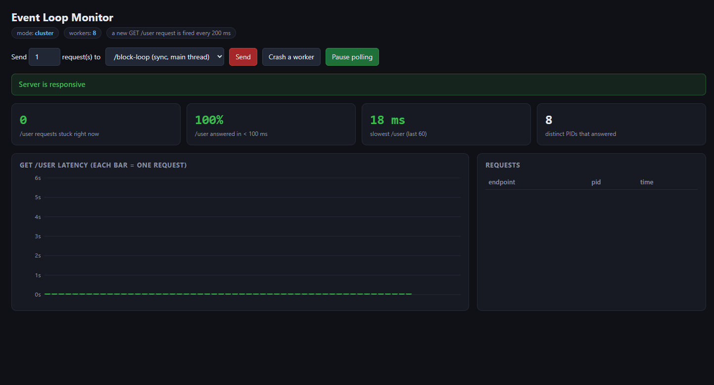

# Node.js cluster demo


```bash
npm install
npm run single      # one process
npm run cluster:4   # cluster with 4 workers
npm run cluster     # cluster with one worker per CPU core
```

Open http://localhost:3000. The dashboard fires `GET /user` every 200 ms and charts each request's latency.

| Endpoint | What it does |
|---|---|
| `GET /user` | Fast JSON response (includes the worker `pid`) |
| `GET /block-loop?ms=5000` | Busy-waits on the main thread and blocks the event loop |
| `GET /block-thread?ms=5000` | Same CPU work inside a `worker_threads` Worker |
| `GET /crash` | Exits the process with code 1, so the cluster primary forks a replacement |
| `GET /info` | Mode, pid, and worker count |

## Demo


Notes:

- Browsers allow about 6 concurrent connections per host, so the dashboard caps "Send" at 5 requests. Use `autocannon` or `curl` for more.
- The server sends `Connection: close` so each request is load-balanced separately. Cluster balances connections, not requests.
#
